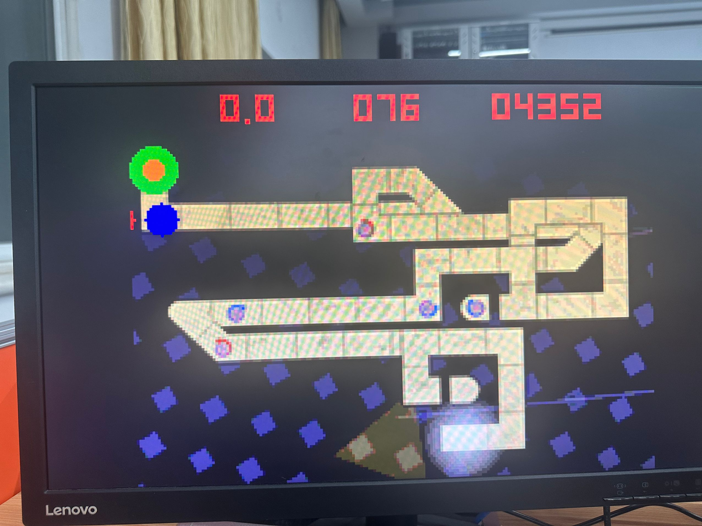
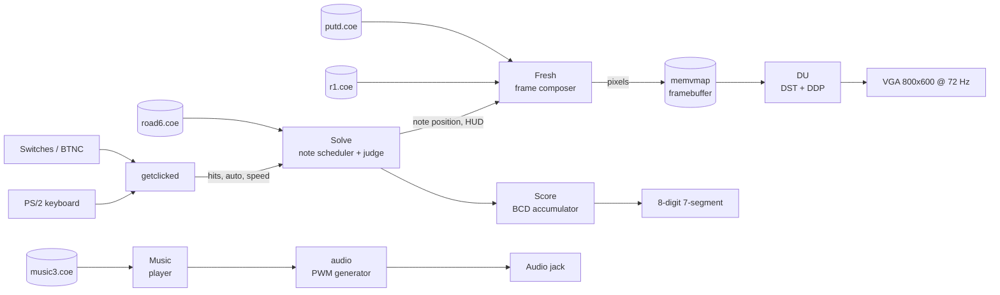

<div align="center">

# 永恒的东风之旅 · Journey of the Eternal East Wind

**A VGA rhythm game for the Digilent Nexys A7-100T, written in Verilog.**

[](LICENSE)
[](docs/hardware.md)
[](docs/rebuilding.md)
[](#project-status)

&nbsp;&nbsp;


</div>

## What is this?

A small rhythm game built for the **USTC 2024 Fall Analog and Digital Circuits Lab (Lab 8)**.
A ball travels along a hand-drawn track; press any key when it reaches a note circle to hit
the note. The soundtrack is the USTC school song *永恒的东风* (Eternal East Wind), rendered on
the fly from a compact note table.

Everything - VGA timing, PS/2 decoding, note scheduling, judging, rendering and audio - runs
inside the FPGA. There is no CPU, no soft core and no software stack. The whole game is about
2,600 lines of Verilog plus six memory images (backgrounds, track, font, sine table and song).

## Features

- 200×150 game canvas, scaled 4× to a 800×600 @ 72 Hz VGA signal (50 MHz pixel clock).
- PS/2 keyboard input with a debouncer and scan-code decoder; BTNC works as an extra hit button.
- Three background pages, eight-colour judgement feedback, score HUD and a note-speed indicator.
- PWM audio output with a music player that advances through a 182-note song table.
- Eight-digit 7-segment score display and status LEDs.
- Auto-play and invincible modes, plus several debug views on the LEDs and 7-segment display.

## Hardware

| Item | Value |
| --- | --- |
| Board | Digilent Nexys A7-100T |
| FPGA | XC7A100T-1CSG324C (Artix-7) |
| Display | VGA monitor, 800×600 @ 72 Hz |
| Input | PS/2 keyboard, BTNC, switches |
| Audio | Mono output (PWM + amplifier enable) |
| Built with | Vivado 2024.1 (bitstream dated 2024-12-29) |

The VGA and PS/2 ports are on the Nexys A7 itself. All 69 top-level ports are mapped in
[`constraints/nexys_a7.xdc`](constraints/nexys_a7.xdc); see [`docs/hardware.md`](docs/hardware.md)
for the signal groups and the board notes.

## Quick start

1. Download `Main.bit` from the [Releases](https://github.com/lyingloong-archive/nexysa7-rhythm-game/releases)
   page (the bitstream is not stored in the source tree).
2. Connect the board's USB-JTAG, a VGA monitor, a PS/2 keyboard and headphones/speakers.
3. Open Vivado → **Hardware Manager** → **Open Target** → **Auto Connect** →
   **Program Device**, then select `Main.bit`.
4. Press BTNC (or any key) once to load the chart, then again to start.

> The game state is initialised at configuration time, so re-programming the bitstream is the
> reliable way to return to the title screen. During play, SW2 jumps back to the title.

## Controls

| Input | Action |
| --- | --- |
| BTNC | Confirm / hit |
| Any key | Hit (except the keys listed below) |
| `1` | Toggle auto-play |
| `2` | Toggle invincible mode |
| `4` / `5` / `6` | Faster / slower / default note speed |
| `9` | Cycle the picture style |
| SW0 | Invincible mode |
| SW2 | Return to the title screen while playing |
| SW3–SW5 | Fixed speed 1–7 (`000` = use the keyboard) |
| SW6 | Auto-play |
| SW7 / SW8 | LED / 7-segment debug view |
| SW10–SW14 | Debug data selector |
| SW15 | LED source (colour mixer or HUD) |
| CPU_RESETN | Reset the video and audio units |

Auto-play is best enabled **after** the song starts: the same signal that generates automatic
hits also suppresses manual ones, so it would otherwise block the start press.

## How it works



The detailed module table, state machines, memory map and timing parameters are in
[`docs/architecture.md`](docs/architecture.md).

## Repository layout

```
.
├── rtl/
│   ├── top/       Main.v - top level
│   ├── game/      note scheduling, judging, frame composer, HUD helpers
│   ├── video/     VGA timing, 4x scaling, 7-segment scan/decode
│   ├── audio/     song player, note decoder, PWM generator
│   ├── input/     PS/2 receiver, debouncer, keyboard/button front end
│   └── common/    counters, BCD adder, binary→BCD converter
├── constraints/   nexys_a7.xdc - all 69 used pins
├── data/
│   ├── coe/       six memory initialisation files
│   └── images/    source background images
├── tools/         image2coe.py and legacy data generators
├── docs/          architecture, hardware, data formats, rebuilding notes
└── docs/images/   screenshots used in this README
```

## Data and assets

The six `.coe` files in [`data/coe/`](data/coe) are the compiled game data:

| File | Size | Used for |
| --- | --- | --- |
| `r1.coe` | 102,400 × 12 bit | three background pages |
| `beginphoto.coe` | 30,000 × 12 bit | title screen |
| `putd.coe` | 1,024 × 12 bit | 5×7 digit font |
| `sin.coe` | 360 × 32 bit | sine/cosine lookup |
| `music3.coe` | 182 × 24 bit (512 entries) | song note table |
| `road6.coe` | 1,000 × 64 bit (1,024 entries) | track geometry and note timing |

The image backgrounds can be regenerated with [`tools/image2coe.py`](tools/image2coe.py).
The chart/road/font/sine generators were the original C++ helpers; they are kept under
[`tools/legacy/`](tools/legacy) for reference, but their input files were not archived.
See [`docs/data-formats.md`](docs/data-formats.md) for the bit layouts.

## Rebuilding from source

The original Vivado project (`.xpr`) and the six Xilinx memory IP cores were **not** preserved
with the archive. The RTL and the full pin constraints are here, but a new bitstream needs those
memory cores recreated first. [`docs/rebuilding.md`](docs/rebuilding.md) documents their
inferred configurations, the read latencies and the Vivado 2024.1 flow.

The RTL was cleaned up in 2026 (naming, headers, dead code, comments) and has been checked to
elaborate with Yosys; it has **not** been re-synthesised or tested on hardware after that
cleanup. The prebuilt bitstream in the release is the known-good reference.

## Project status

Archived coursework. No further development, no support and no guarantees. Issues are welcome
if something is clearly broken, but there are no plans to port the design to other boards or to
add features.

## Credits

- 高华成 (Huacheng Gao) and 王昊 (Hao Wang), USTC.
- USTC 2024 Fall *模拟与数字电路实验* (Analog and Digital Circuits Lab), Lab 8.
- VGA timing, PS/2 and 7-segment reference material comes from the course lab handouts and
  common public FPGA examples.

## License

The Verilog, scripts and documentation are released under the [MIT License](LICENSE).
The music and image assets are covered by [`NOTICE.md`](NOTICE.md).
