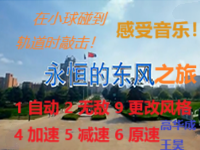
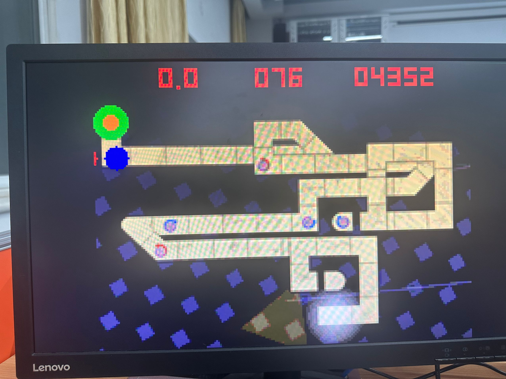
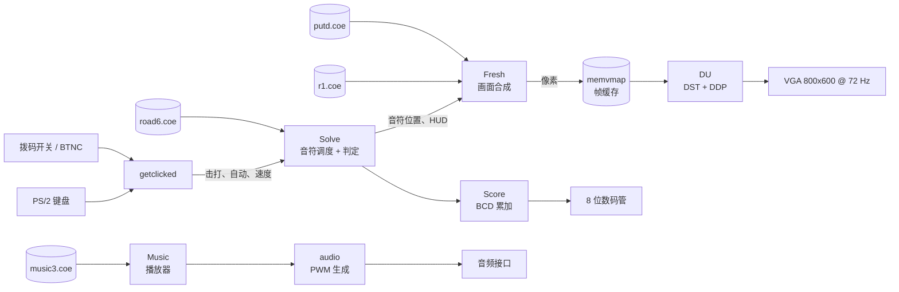

<div align="center">

# 永恒的东风之旅

**基于 Verilog 的 Nexys A7 VGA 音游**

[](LICENSE)
[](docs/hardware.md)
[](docs/rebuilding.md)
[](#项目状态)

&nbsp;&nbsp;


</div>

## 这是什么

这是 **中国科学技术大学 2024 秋季《模拟与数字电路实验》Lab 8** 的课程项目。小球沿着手绘的
轨道前进，在到达音符圈时按下任意键即可击中音符。背景音乐是校歌《永恒的东风》，由一张 182
条的乐谱表在 FPGA 内部实时合成。

VGA 时序、PS/2 解码、音符调度、判定、画面合成与音频全部由 FPGA 完成，没有 CPU、没有软核、
也没有软件栈。整个项目约 2600 行 Verilog，外加 6 份存储器数据（背景、轨道、字模、正弦表、乐谱）。

> English version: [README.md](README.md)

## 特性

- 200×150 的游戏画布，4 倍放大后输出 800×600 @ 72 Hz VGA（像素时钟 50 MHz）。
- PS/2 键盘输入（带消抖和扫描码解码），BTNC 也可以作为击打键。
- 三张背景页、8 档判定颜色、分数 HUD 和音符速度指示。
- PWM 音频输出，音乐播放器按 182 条音符表推进。
- 8 位数码管显示分数，LED 显示状态。
- 自动演奏、无敌模式，以及若干 LED / 数码管调试视图。

## 硬件

| 项目 | 说明 |
| --- | --- |
| 开发板 | Digilent Nexys A7-100T |
| FPGA | XC7A100T-1CSG324C（Artix-7） |
| 显示 | VGA 显示器，800×600 @ 72 Hz |
| 输入 | PS/2 键盘、BTNC、拨码开关 |
| 音频 | 单声道输出（PWM + 功放使能） |
| 构建 | Vivado 2024.1（bitstream 日期 2024-12-29） |

VGA 和 PS/2 接口是 Nexys A7 板载的。顶层 69 个端口全部在
[`constraints/nexys_a7.xdc`](constraints/nexys_a7.xdc) 中约束，信号分组和板卡说明见
[`docs/hardware.md`](docs/hardware.md)。

## 快速开始

1. 从 [Releases](https://github.com/lyingloong-archive/nexysa7-rhythm-game/releases) 下载
   `Main.bit`（bitstream 不放在源码树里）。
2. 连接开发板的 USB-JTAG、VGA 显示器、PS/2 键盘和耳机/音箱。
3. 打开 Vivado → **Hardware Manager** → **Open Target** → **Auto Connect** →
   **Program Device**，选择 `Main.bit`。
4. 按一次 BTNC（或任意键）载入谱面，再按一次开始。

> 游戏状态是在配置时初始化的，所以重新下载 bitstream 是回到标题界面最可靠的方式；
> 游戏中可以按 SW2 直接回到标题。

## 操作

| 输入 | 功能 |
| --- | --- |
| BTNC | 确认 / 击打 |
| 任意键 | 击打（下面列出的功能键除外） |
| `1` | 自动演奏开关 |
| `2` | 无敌模式开关 |
| `4` / `5` / `6` | 加速 / 减速 / 恢复默认速度 |
| `9` | 切换画面风格 |
| SW0 | 无敌模式 |
| SW2 | 游戏中回到标题 |
| SW3–SW5 | 固定速度 1–7（`000` = 用键盘微调） |
| SW6 | 自动演奏 |
| SW7 / SW8 | LED / 数码管调试视图 |
| SW10–SW14 | 调试数据选择 |
| SW15 | LED 数据源（颜色混合器或 HUD） |
| CPU_RESETN | 复位视频与音频单元 |

建议**先开始歌曲、再打开自动演奏**：产生自动击打的同一个信号也会屏蔽手动输入，
如果一开始就打开，会挡住开始按键。

## 原理



模块表、状态机、存储器映射和时序参数见 [`docs/architecture.md`](docs/architecture.md)。

## 目录结构

```
.
├── rtl/
│   ├── top/       顶层 Main.v
│   ├── game/      音符调度、判定、画面合成、HUD
│   ├── video/     VGA 时序、4 倍缩放、数码管扫描/解码
│   ├── audio/     音乐播放器、音符解码、PWM
│   ├── input/     PS/2 接收、消抖、键盘与按键前端
│   └── common/    计数器、BCD 加法器、二进制转 BCD
├── constraints/   nexys_a7.xdc（69 个端口）
├── data/
│   ├── coe/       6 份存储器初始化文件
│   └── images/    背景源图
├── tools/         image2coe.py 与旧版数据生成器
├── docs/          架构、硬件、数据格式、重建说明
└── docs/images/   README 使用的截图
```

## 数据与素材

[`data/coe/`](data/coe) 里的 6 个 `.coe` 是编译好的游戏数据：

| 文件 | 大小 | 用途 |
| --- | --- | --- |
| `r1.coe` | 102,400 × 12 bit | 三张背景页 |
| `beginphoto.coe` | 30,000 × 12 bit | 标题画面 |
| `putd.coe` | 1,024 × 12 bit | 5×7 数字字模 |
| `sin.coe` | 360 × 32 bit | 正弦/余弦查表 |
| `music3.coe` | 182 × 24 bit（容量 512） | 乐曲音符表 |
| `road6.coe` | 1,000 × 64 bit（容量 1024） | 轨道几何与音符时序 |

背景图可以用 [`tools/image2coe.py`](tools/image2coe.py) 重新生成。谱面、轨道、字模和正弦表
由原来的 C++ 小工具生成，工具保留在 [`tools/legacy/`](tools/legacy) 供参考，但它们的输入文件
没有归档。各位布局见 [`docs/data-formats.md`](docs/data-formats.md)。

## 从源码重建

原始的 Vivado 工程（`.xpr`）和 6 个 Xilinx 存储器 IP 没有随仓库保留。RTL 和完整的引脚约束
都在，但要重新生成 bitstream，需要先按 [`docs/rebuilding.md`](docs/rebuilding.md) 里的推断配置
重建这些 IP。

2026 年的清理（命名、文件头、死代码、注释）之后，RTL 已用 Yosys 做过 elaboration 检查，
但**没有**重新综合，也没有再上板验证。Release 里的 bitstream 是已知可用的参考版本。

## 项目状态

课程归档项目。不再开发、不提供支持、不保证可用。发现明显问题时欢迎提 issue，但没有移植到
其他开发板或增加新功能的计划。

## 致谢

- 高华成（USTC）、王昊（USTC）
- 中国科学技术大学 2024 秋季《模拟与数字电路实验》Lab 8
- VGA 时序、PS/2 与数码管部分参考了课程实验讲义和常见的公开 FPGA 示例

## 许可证

Verilog、脚本和文档使用 [MIT License](LICENSE)。音乐与图片素材见 [`NOTICE.md`](NOTICE.md)。
